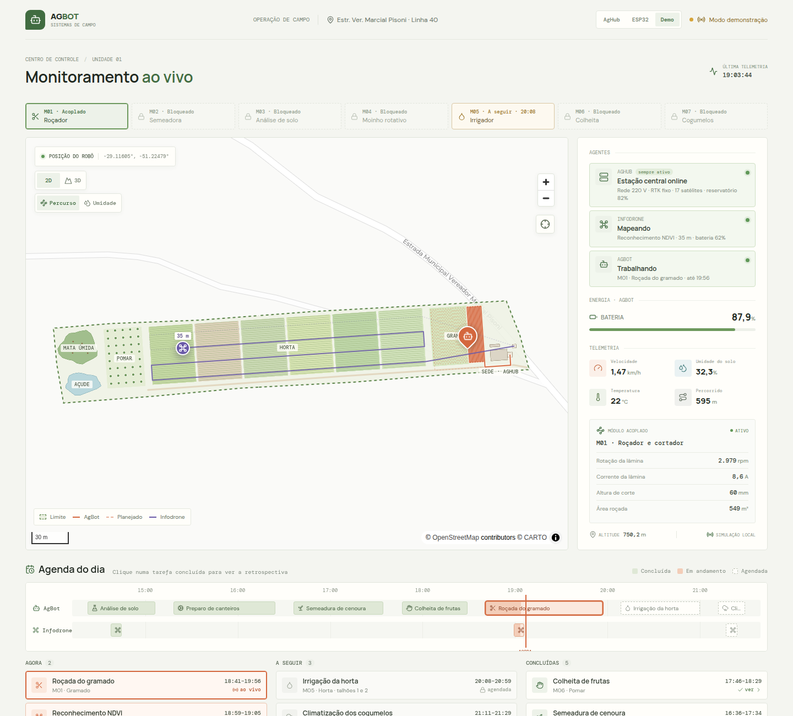
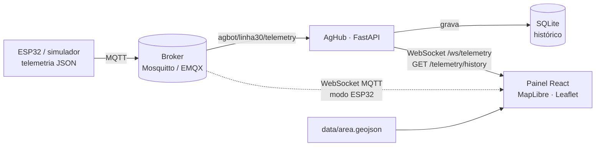

<div align="center">

# Terra Sana · Plataforma AgBot

**Robótica agrícola aberta, modular e solar para a agricultura familiar e agroecológica.**

[Site do projeto](https://marcelogiazzon.github.io/TerraSana/) ·
[Painel ao vivo](https://marcelogiazzon.github.io/TerraSana/painel/) ·
[Plano diretor](Visao/documento_master_agbot.md) ·
[Arquitetura técnica](Visao/agbot_opensource_technical_specifications.md)



</div>

## Sobre

O **AgBot** é um ecossistema de três agentes que trabalham juntos na propriedade rural:

| Agente | Papel |
| :--- | :--- |
| **AgBot** | Base terrestre elétrica (24 V, esteiras, RTK-GNSS) com engate rápido para ferramentas |
| **Infodrone** | Unidade aérea de reconhecimento que mapeia a área e apoia o planejamento das missões |
| **AgHub** | Estação local de comunicação, recarga e processamento na borda |

Sobre a mesma base, **sete módulos intercambiáveis** cobrem o ciclo produtivo:

| # | Módulo | Função | Custo est. |
| :---: | :--- | :--- | ---: |
| 01 | [Roçador e cortador](Robos/Modulos/01_Rocador_Cortador/README.md) | Manejo de vegetação sem herbicidas | R$ 2.200 |
| 02 | [Semeadora e adubadeira](Robos/Modulos/02_Semeadora_Adubadeira/README.md) | Dosagem sincronizada à odometria | R$ 1.800 |
| 03 | [Análise de solo profundo](Robos/Modulos/03_Sensor_Solo_Profundo/README.md) | Amostragem georreferenciada (pH, NPK, compactação) | R$ 1.650 |
| 04 | [Moinho rotativo](Robos/Modulos/04_Moinho%20Rotativo/README.md) | Preparo localizado de canteiros | R$ 2.100 |
| 05 | [Irrigador e pulverizador](Robos/Modulos/05_Irrigador_Pulverizador/README.md) | Irrigação e bioinsumos micro-localizados | R$ 1.900 |
| 06 | [Braço de colheita](Robos/Modulos/06_Braco_Colheita/README.md) | Colheita seletiva por visão computacional | R$ 4.900 |
| 07 | [Climatização e cogumelos](Robos/Modulos/07_Cogumelo_Climatizacao/README.md) | Controle de microclima para fungicultura | R$ 1.450 |

## Estado atual

| Componente | Status |
| :--- | :--- |
| Site institucional e fichas dos módulos | ✅ Publicado |
| Simulador de telemetria (Python → MQTT) | ✅ Funcional |
| Simulador dos 7 módulos, cada um com suas métricas | ✅ Funcional |
| Backend AgHub (FastAPI, MQTT → WebSocket, histórico em SQLite) | ✅ Funcional |
| Painel de monitoramento (React, MapLibre 2D/3D, gráficos e mapa de umidade) | ✅ Funcional, com modo demonstração |
| Firmware ESP32 do módulo M04 (Wokwi), visível no painel público | 🧪 Simulação |
| Hardware físico | 📐 Em especificação |

## Arquitetura de software



## Estrutura do repositório

```
├── index.html, documento.html     Site institucional e leitor de documentos
├── modulos/                       Páginas dos 7 módulos
├── assets/                        Imagens e favicon do site
├── frontend/                      Painel de telemetria (React + Vite)
├── backend/                       API AgHub (FastAPI + MQTT + WebSocket)
├── simulation/                    Simulador de telemetria do robô
├── firmware/                      Firmware ESP32 do módulo M04 (Wokwi)
├── data/                          Limite da propriedade (GeoJSON)
├── infra/                         Configuração do broker MQTT local
├── Visao/                         Plano diretor, apresentação e projetos de fomento
└── Robos/Modulos/                 Fichas técnicas e BOM de cada módulo
```

## Como executar

### Opção 1 · Docker (broker + simulador + backend)

```bash
docker compose up --build
# API em http://localhost:8010  (troque com BACKEND_PORT=<porta> se precisar)
```

Depois inicie o painel (passo 4 abaixo) — ele conecta em `ws://localhost:8010/ws/telemetry`.

### Opção 2 · Manual

**1. Ambiente Python**
```bash
cd backend
python3 -m venv .venv
.venv/bin/pip install -r requirements.txt
```

**2. Simulador de telemetria** (na raiz do repositório)
```bash
backend/.venv/bin/python simulation/telemetry_engine.py
```

**3. Backend**
```bash
backend/.venv/bin/uvicorn main:app --app-dir backend --reload --host 0.0.0.0 --port 8010
```

**4. Painel**
```bash
cd frontend
npm install
npm run dev        # http://localhost:5173
```

Por padrão o simulador e o backend usam o broker público `broker.emqx.io`; defina `MQTT_BROKER=localhost` para usar um broker local.

### Variáveis de ambiente

| Variável | Onde | Padrão |
| :--- | :--- | :--- |
| `MQTT_BROKER` / `MQTT_PORT` / `MQTT_TOPIC` | backend, simulador | `broker.emqx.io` / `1883` / `agbot/linha30/telemetry` |
| `CORS_ORIGINS` | backend | `http://localhost:5173,http://127.0.0.1:5173` |
| `DB_PATH` | backend | `backend/data/telemetry.db` |
| `HISTORY_RETENTION_DAYS` | backend | `7` |
| `MODULE_ROTATION_S` | simulador | `120` (troca de módulo a cada 2 min) |
| `ACTIVE_MODULE` | simulador | vazio (gira os 7); ex.: `M03` fixa a análise de solo |
| `PUBLISH_INTERVAL_S` | simulador | `2` |
| `VITE_WS_URL` | painel | `ws://<host>:8010/ws/telemetry` |
| `VITE_MQTT_WS_URL` / `VITE_MQTT_TOPIC` | painel (modo ESP32) | `wss://broker.emqx.io:8084/mqtt` / `agbot/linha30/telemetry` |
| `VITE_WOKWI_URL` | painel (modo ESP32) | vazio (link do projeto no Wokwi) |

### Endpoints

| Rota | Descrição |
| :--- | :--- |
| `GET /health` | Estado da API e da conexão MQTT |
| `GET /telemetry/latest` | Última mensagem recebida (recuperada do banco ao reiniciar) |
| `GET /telemetry/history?minutes=120&limit=3000&robot_id=` | Leituras gravadas: posição, bateria, umidade e módulo |
| `WS /ws/telemetry` | Fluxo contínuo de telemetria |

### Testes

```bash
backend/.venv/bin/pip install -r backend/requirements-dev.txt
cd backend && .venv/bin/python -m pytest -q tests
```

O workflow [`testes.yml`](.github/workflows/testes.yml) roda os testes e o build do painel a cada push.

## Fontes de dados do painel

O seletor no topo do painel escolhe de onde vem a telemetria (também pela URL, com `?fonte=`):

| Fonte | De onde vêm os dados | Histórico |
| :--- | :--- | :--- |
| **AgHub** (só local) | Backend em `ws://localhost:8010` | Gravado em SQLite; o painel carrega as últimas 2 horas ao abrir |
| **ESP32** | Broker MQTT público via WebSocket, onde o firmware no Wokwi publica | Desde que o painel foi aberto |
| **Demo** | Um dia de operação simulado no navegador (padrão no site publicado) | Agenda do dia com retrospectiva de cada tarefa concluída |

O AgBot leva **um módulo por vez**: a faixa de módulos mostra o acoplado, o próximo da agenda e os demais bloqueados.

### Modo demonstração: um dia na propriedade

O modo **Demo** simula um dia de trabalho com três agentes ativos ao mesmo tempo: o **AgHub** (sempre ligado), o **Infodrone** e o **AgBot** com um módulo acoplado.

- **Agenda do dia:** uma linha do tempo por agente e listas *Agora*, *A seguir* e *Concluídas* (por exemplo: roçando o gramado agora, depois irrigação da horta e climatização dos cogumelos).
- **Retrospectiva da atividade:** clicar numa tarefa concluída mostra o trabalho do início ao fim, com barra de tempo e reprodução em 1x, 2x, 4x, 8x, 16x ou 32x. O mapa, os agentes, o módulo e os gráficos acompanham o horário da reprodução.
- **Percursos coerentes com cada serviço:** faixas de roçada no gramado, linhas de canteiro na horta, paradas de amostragem do solo, árvores do pomar, corredor da câmara de cogumelos e voos do drone (mapeamento NDVI e nebulização das toras de shiitake).

A simulação é determinística em função do horário ([`simulate.js`](frontend/src/simulate.js)): o ao vivo e a retrospectiva usam o mesmo cálculo. A agenda fica em [`plan.js`](frontend/src/plan.js).

O painel publicado também recebe o ESP32: abra [o painel no modo ESP32](https://marcelogiazzon.github.io/TerraSana/painel/?fonte=esp32), inicie a simulação no Wokwi (veja o [firmware](firmware/README.md)) e as leituras aparecem no mapa.

## Formato da telemetria

```json
{
  "robot_id": "agbot_prototipo_v1",
  "timestamp": 1793825324,
  "location": { "latitude": -29.116169, "longitude": -51.22466, "altitude_m": 750.2 },
  "status": { "battery_percent": 99.84, "active_module": "M03_SOLO_PROFUNDO", "speed_kmh": 1.46, "e_stop": false },
  "module_telemetry": { "nitrogen_mg_kg": 31.2, "phosphorus_mg_kg": 14.8, "potassium_mg_kg": 121.5, "ph": 6.2, "probe_depth_cm": 30 },
  "environmental": { "soil_moisture_percent": 34.1, "ambient_temp_c": 21.2 }
}
```

| Módulo (`active_module`) | Campos em `module_telemetry` |
| :--- | :--- |
| `M01_ROCADOR` | `blade_rpm`, `blade_current_amp`, `cut_height_mm`, `area_cut_m2` |
| `M02_SEMEADORA` | `seeds_planted`, `seed_spacing_cm`, `hopper_level_percent`, `fertilizer_g_m` |
| `M03_SOLO_PROFUNDO` | `nitrogen_mg_kg`, `phosphorus_mg_kg`, `potassium_mg_kg`, `ph`, `probe_depth_cm` |
| `M04_MOINHO_ROTATIVO` | `motor_current_amp`, `soil_resistance_index`, `depth_cm` |
| `M05_IRRIGADOR` | `tank_level_percent`, `flow_lpm`, `pressure_bar`, `applied_l` |
| `M06_COLHEITA` | `harvested_count`, `detection_confidence_percent`, `grip_force_n`, `cycle_time_s` |
| `M07_COGUMELOS` | `co2_ppm`, `air_humidity_percent`, `air_temp_c`, `fogger_on` |

As métricas exibidas de cada módulo ficam em [`frontend/src/modules.js`](frontend/src/modules.js). O formato antigo do M04 (`telemetry_m04`) continua aceito.

## Mapa e terreno 3D

- O modo 3D usa MapLibre com elevação Terrarium e requer WebGL2.
- Sem WebGL2, o painel usa Leaflet com tiles raster do OpenStreetMap em 2D.
- O contorno da propriedade segue a medição original ([`data/area-medicao.png`](data/area-medicao.png)): uma faixa de ~372 m × 57 m, levemente inclinada, com o portão junto à estrada e o açude a oeste. As zonas (sede, gramado, horta em 6 talhões, pomar, mata úmida e açude) ficam em [`frontend/src/farm.js`](frontend/src/farm.js), e o contorno exportado em [`data/area.geojson`](data/area.geojson).
- A camada **Umidade** agrupa as leituras em células de ~4 m e mostra a média de cada uma, numa escala de um só tom (claro = seco, escuro = úmido).

## Publicação

O workflow [`.github/workflows/pages.yml`](.github/workflows/pages.yml) publica o site e o painel no GitHub Pages a cada push na `main`. Para ativar: *Settings → Pages → Source: GitHub Actions*.

## Tecnologias

**IoT:** ESP32, MQTT · **Backend:** Python, FastAPI, paho-mqtt · **Frontend:** React, Vite, MapLibre GL, Leaflet · **GIS:** GeoJSON, OpenStreetMap/CARTO, Terrarium · **Robótica (planejado):** ROS 2, RTK-GNSS
