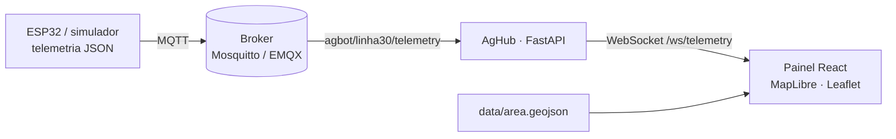

<div align="center">

# Terra Sana · Plataforma AgBot

**Robótica agrícola aberta, modular e solar para a agricultura familiar e agroecológica.**

[Site do projeto](https://marcelogiazzon.github.io/TerraSana/) ·
[Painel ao vivo](https://marcelogiazzon.github.io/TerraSana/painel/) ·
[Plano diretor](Visao/documento_master_agbot.md) ·
[Arquitetura técnica](Visao/agbot_opensource_technical_specifications.md)


</div>

## Sobre

O **AgBot** é um ecossistema de três agentes que trabalham juntos na propriedade rural:

| Agente | Papel |
| :--- | :--- |
| **AgBot** | Base terrestre elétrica (24 V, esteiras, RTK-GNSS) com engate rápido para ferramentas |
| **Infodrone** | Unidade aérea de reconhecimento que mapeia a área e apoia o planejamento das missões |
| **AgHub** | Estação local de comunicação, recarga e processamento na borda |

Sobre a mesma base, **sete módulos intercambiáveis** cobrem o ciclo produtivo:

| # | Módulo | Função | Custo est. |
| :---: | :--- | :--- | ---: |
| 01 | [Roçador e cortador](Robos/Modulos/01_Rocador_Cortador/README.md) | Manejo de vegetação sem herbicidas | R$ 2.200 |
| 02 | [Semeadora e adubadeira](Robos/Modulos/02_Semeadora_Adubadeira/README.md) | Dosagem sincronizada à odometria | R$ 1.800 |
| 03 | [Análise de solo profundo](Robos/Modulos/03_Sensor_Solo_Profundo/README.md) | Amostragem georreferenciada (pH, NPK, compactação) | R$ 1.650 |
| 04 | [Moinho rotativo](Robos/Modulos/04_Moinho%20Rotativo/README.md) | Preparo localizado de canteiros | R$ 2.100 |
| 05 | [Irrigador e pulverizador](Robos/Modulos/05_Irrigador_Pulverizador/README.md) | Irrigação e bioinsumos micro-localizados | R$ 1.900 |
| 06 | [Braço de colheita](Robos/Modulos/06_Braco_Colheita/README.md) | Colheita seletiva por visão computacional | R$ 4.900 |
| 07 | [Climatização e cogumelos](Robos/Modulos/07_Cogumelo_Climatizacao/README.md) | Controle de microclima para fungicultura | R$ 1.450 |

## Estado atual

| Componente | Status |
| :--- | :--- |
| Site institucional e fichas dos módulos | ✅ Publicado |
| Simulador de telemetria (Python → MQTT) | ✅ Funcional |
| Backend AgHub (FastAPI, MQTT → WebSocket) | ✅ Funcional |
| Painel de monitoramento (React, MapLibre 2D/3D) | ✅ Funcional, com modo demonstração |
| Firmware ESP32 do módulo M04 (Wokwi) | 🧪 Simulação |
| Hardware físico | 📐 Em especificação |

## Arquitetura de software



## Estrutura do repositório

```
├── index.html, documento.html     Site institucional e leitor de documentos
├── modulos/                       Páginas dos 7 módulos
├── assets/                        Imagens e favicon do site
├── frontend/                      Painel de telemetria (React + Vite)
├── backend/                       API AgHub (FastAPI + MQTT + WebSocket)
├── simulation/                    Simulador de telemetria do robô
├── firmware/                      Firmware ESP32 do módulo M04 (Wokwi)
├── data/                          Limite da propriedade (GeoJSON)
├── infra/                         Configuração do broker MQTT local
├── Visao/                         Plano diretor, apresentação e projetos de fomento
└── Robos/Modulos/                 Fichas técnicas e BOM de cada módulo
```

## Como executar

### Opção 1 · Docker (broker + simulador + backend)

```bash
docker compose up --build
# API em http://localhost:8010  (troque com BACKEND_PORT=<porta> se precisar)
```

Depois inicie o painel (passo 4 abaixo) — ele conecta em `ws://localhost:8010/ws/telemetry`.

### Opção 2 · Manual

**1. Ambiente Python**
```bash
cd backend
python3 -m venv .venv
.venv/bin/pip install -r requirements.txt
```

**2. Simulador de telemetria** (na raiz do repositório)
```bash
backend/.venv/bin/python simulation/telemetry_engine.py
```

**3. Backend**
```bash
backend/.venv/bin/uvicorn main:app --app-dir backend --reload --host 0.0.0.0 --port 8010
```

**4. Painel**
```bash
cd frontend
npm install
npm run dev        # http://localhost:5173
```

Por padrão o simulador e o backend usam o broker público `broker.emqx.io`; defina `MQTT_BROKER=localhost` para usar um broker local.

### Variáveis de ambiente

| Variável | Onde | Padrão |
| :--- | :--- | :--- |
| `MQTT_BROKER` / `MQTT_PORT` / `MQTT_TOPIC` | backend, simulador | `broker.emqx.io` / `1883` / `agbot/linha30/telemetry` |
| `CORS_ORIGINS` | backend | `http://localhost:5173,http://127.0.0.1:5173` |
| `VITE_WS_URL` | painel | `ws://<host>:8010/ws/telemetry` |

### Endpoints

| Rota | Descrição |
| :--- | :--- |
| `GET /health` | Estado da API e da conexão MQTT |
| `GET /telemetry/latest` | Última mensagem recebida |
| `WS /ws/telemetry` | Fluxo contínuo de telemetria |

## Modo demonstração

Quando não há backend disponível — como no site publicado — o painel gera a telemetria no próprio navegador, com o mesmo padrão de varredura do simulador. Localmente, force com `http://localhost:5173/?demo`.

## Mapa e terreno 3D

- O modo 3D usa MapLibre com elevação Terrarium e requer WebGL2.
- Sem WebGL2, o painel usa Leaflet com tiles raster do OpenStreetMap em 2D.
- O limite da propriedade vem de [`data/area.geojson`](data/area.geojson).

## Publicação

O workflow [`.github/workflows/pages.yml`](.github/workflows/pages.yml) publica o site e o painel no GitHub Pages a cada push na `main`. Para ativar: *Settings → Pages → Source: GitHub Actions*.

## Tecnologias

**IoT:** ESP32, MQTT · **Backend:** Python, FastAPI, paho-mqtt · **Frontend:** React, Vite, MapLibre GL, Leaflet · **GIS:** GeoJSON, OpenStreetMap/CARTO, Terrarium · **Robótica (planejado):** ROS 2, RTK-GNSS
